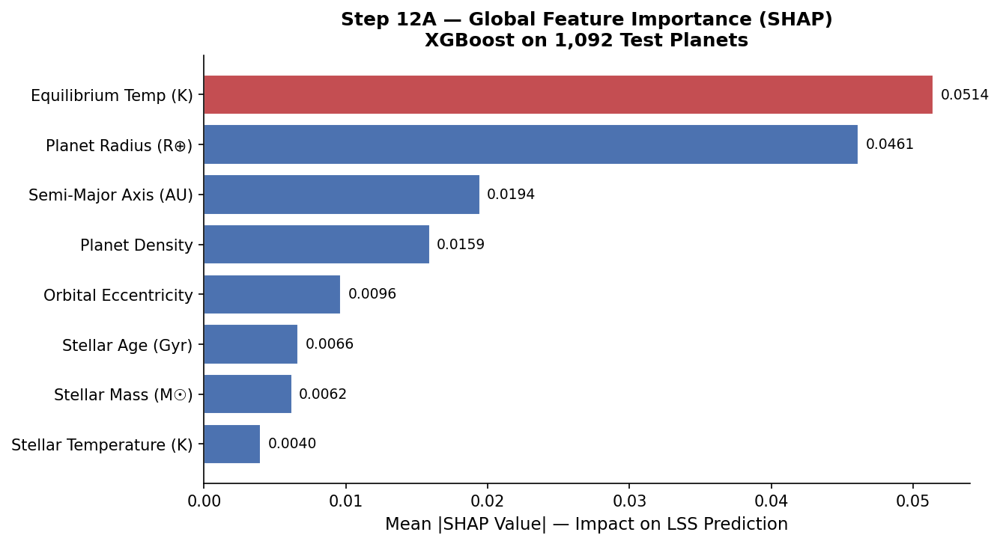
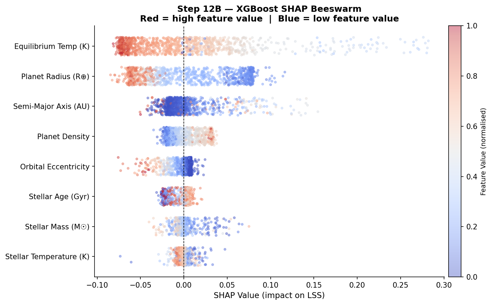
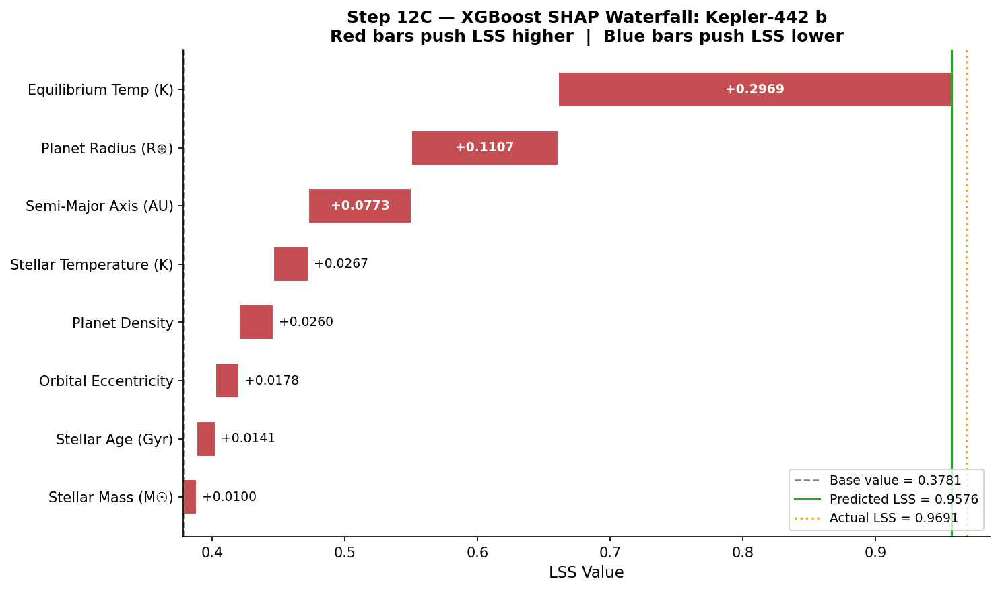
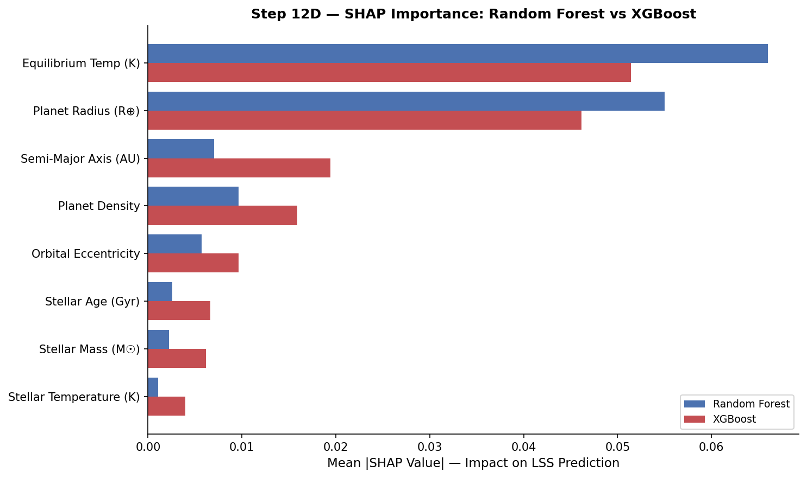
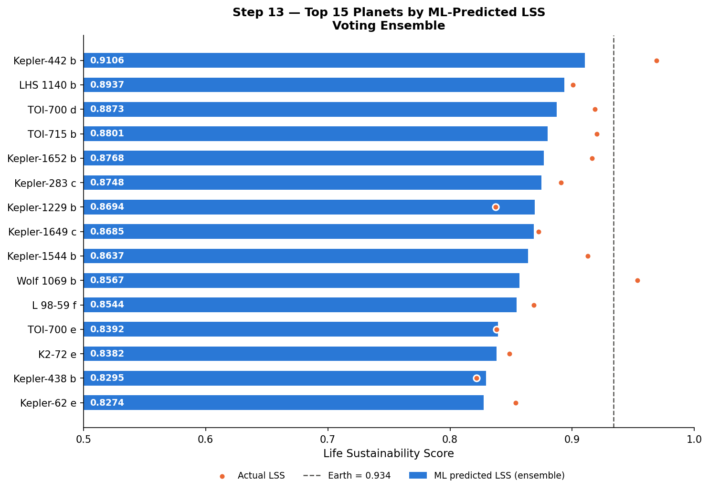
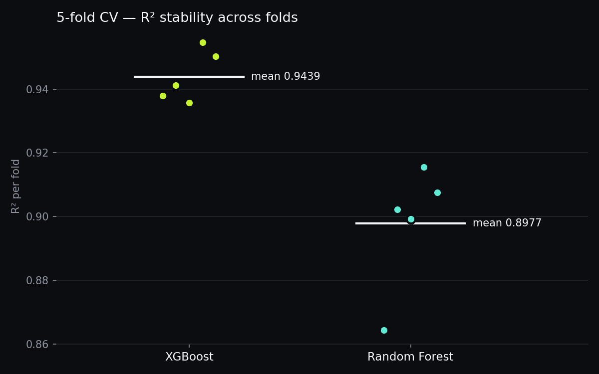
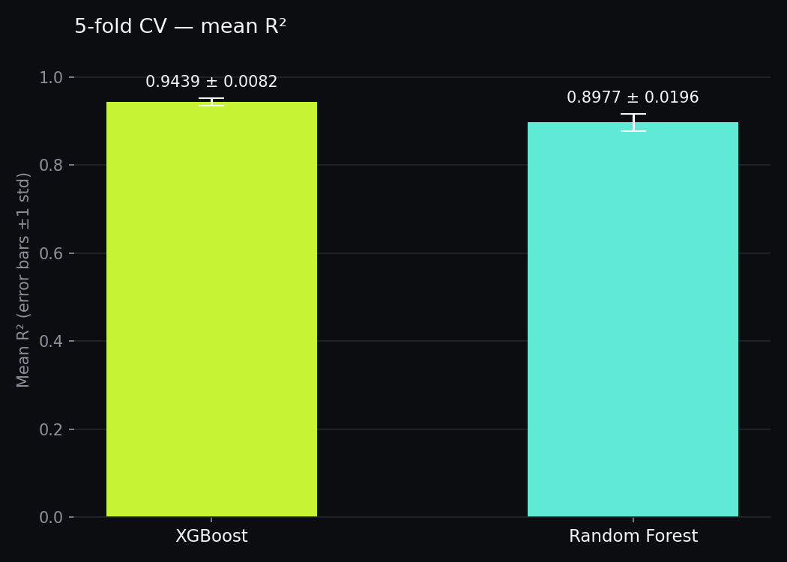

# Beyond Binary: Estimating Life Sustainability Scores in Exoplanets

An end-to-end machine-learning pipeline that takes the NASA Exoplanet Archive's planetary-systems composite table, cleans it, builds a domain-informed **Life Sustainability Score (LSS)** on a 0–1 scale for every planet, trains regression models to predict that score from eight observable planetary and stellar features, explains the models with SHAP, ranks all 5,456 surviving planets, and serves everything through an interactive Streamlit dashboard with a Vision-RAG assistant.

> Every number in this document was taken from the saved notebook outputs, CSV files, figures and scripts in this repository. Where two artefacts disagree, both values are given and the source of each is named (see [§13 Artefact versions and consistency notes](#13-artefact-versions-and-consistency-notes)).

---

## Contents

1. [Headline results](#1-headline-results)
2. [Repository layout](#2-repository-layout)
3. [Data source](#3-data-source)
4. [Preprocessing pipeline (Steps 1–8)](#4-preprocessing-pipeline-steps-18)
5. [The Life Sustainability Score (Step 7)](#5-the-life-sustainability-score-step-7)
6. [Model training and evaluation (Steps 9–10)](#6-model-training-and-evaluation-steps-910)
7. [5-fold cross-validation](#7-5-fold-cross-validation)
8. [Explainability with SHAP (Steps 11–12)](#8-explainability-with-shap-steps-1112)
9. [Full planet watchlist (Step 13)](#9-full-planet-watchlist-step-13)
10. [LSS weight sensitivity analysis (Step 14)](#10-lss-weight-sensitivity-analysis-step-14)
11. [Figure catalogue — every output image](#11-figure-catalogue--every-output-image)
12. [Interactive dashboard and Vision RAG](#12-interactive-dashboard-and-vision-rag)
13. [Artefact versions and consistency notes](#13-artefact-versions-and-consistency-notes)
14. [Limitations](#14-limitations)
15. [Reproducing the project](#15-reproducing-the-project)
16. [Authors and license](#16-authors-and-license)

---

## 1. Headline results

| Item | Value | Source |
|---|---|---|
| Raw catalogue | 6,128 planets × 54 columns | Notebook Step 1 |
| Planets after cleaning | 5,456 (672 removed, 11.0 %) | Notebook Step 4 |
| Model features | 8 (`pl_rade`, `pl_dens`, `pl_orbeccen`, `pl_eqt`, `pl_orbsmax`, `st_teff`, `st_mass`, `st_age`) | Notebook Step 6 |
| Train / test split | 4,364 / 1,092 (80/20, stratified on LSS quintiles) | Notebook Step 8 |
| Best model (held-out test) | **XGBoost — R² 0.9500, MAE 0.0134, RMSE 0.0278** | `outputs/model_comparison_with_ensemble.csv` |
| Voting ensemble (RF + XGB + NN) | R² 0.9406, MAE 0.0143, RMSE 0.0303 | same |
| 5-fold CV, XGBoost | R² 0.9439 ± 0.0082 (MAE 0.0133 ± 0.0007) | `outputs/cv_results.csv` |
| 5-fold CV, Random Forest | R² 0.8977 ± 0.0196 (MAE 0.0201 ± 0.0012) | same |
| Most important feature (SHAP, both RF and XGB) | Equilibrium temperature | Steps 11–12 |
| Highest-LSS planet | Kepler-442 b, LSS 0.9691 | Step 7 |
| Earth benchmark LSS | 0.9340 (only Kepler-442 b and Wolf 1069 b score higher) | Step 7 |
| Weight robustness | Kepler-442 b ranked #1 in 35/35 weight scenarios; top 5 unchanged in 34/35 | Step 14 logic (dashboard) |

---

## 2. Repository layout

```
exoplanet_project/
├── data/PSCompPars_2026.03.05_02.02.54.csv   Raw NASA Exoplanet Archive export (6,128 × 54)
├── exoplanet_preprocessing.ipynb             MAIN notebook: Steps 1–14 (18 cells)
├── notebooks/exoplanet_preprocessing.ipynb   Copy of Steps 1–8 only
├── EXTRAS/exoplanetclean.ipynb               Annotated earlier version of Steps 1–8 + audit;
│                                             generates the 14 figures in IMAGES/
├── EXTRAS/*.csv                              Stage outputs (Steps 3–7) used by Steps 11–13 and cv_analysis.py
├── extra csv/*.csv                           Another copy of the Step 3–7 stage outputs (see §13)
├── exoplanets_step7_*.csv                    Step 7 outputs at the project root (see §13)
├── TRAIN_TEST/                               Train/test splits the saved models were trained on
├── outputs/
│   ├── model_comparison.csv                  Step 9 metrics (4 models)
│   ├── model_comparison_with_ensemble.csv    Step 10 metrics (5 models)
│   ├── full_planet_watchlist.csv             Step 13 ranking of all 5,456 planets (21 columns)
│   ├── cv_results.csv                        5-fold CV, per fold
│   ├── step9_* … step13_*.png, cv_*.png      Evaluation, SHAP, watchlist and CV figures
│   ├── splits/                               Train/test splits from the current Step 8 code (see §13)
│   └── checkpoints/                          Raw backup, selected columns, Step 7 snapshot
├── IMAGES/                                   14 preprocessing figures (Steps 3–8)
├── metadata/transform_metadata.json          Step 5 log-transform decisions
├── models/robust_scaler.pkl                  RobustScaler saved by a Step 8 run
├── model_ridge_regression.pkl, model_random_forest.pkl, model_xgboost.pkl,
│   model_neural_network.pkl, model_ensemble.pkl   Trained models (Steps 9–10)
├── cv_analysis.py                            5-fold cross-validation script
├── app.py                                    Streamlit dashboard ("Beyond Binary")
├── Vision_RAG/                               Multimodal RAG (Cohere Embed-4 + Gemini 2.5 Flash)
├── .streamlit/config.toml                    Dashboard theme
├── PROJECT_IMPLEMENTATION.md                 Earlier long-form write-up (Steps 1–11)
└── STEP3_FINDINGS.md                         Notes on the imputation step
```

---

## 3. Data source

- **Archive:** NASA Exoplanet Archive, *Planetary Systems Composite Parameters* (`PSCompPars`) table.
- **Export timestamp** (file header): Thu Mar 5 02:02:54 2026.
- **Size:** 6,128 confirmed planets × 54 columns (central values plus upper/lower uncertainty and limit-flag columns).
- **Loader:** `pd.read_csv(..., comment="#")` skips the archive's commented header.

### Selected columns (Step 2)

Only central estimates were kept; all uncertainty (`err1`/`err2`) and limit-flag columns were dropped. Units are taken from the archive file header.

| Group | Column | Archive description [unit] | Missing | % Missing | Imputation |
|---|---|---|---|---|---|
| ID | `pl_name` | Planet Name | 0 | 0.0 | — |
| ID | `hostname` | Host Name | 0 | 0.0 | — |
| Planetary | `pl_rade` | Planet Radius [Earth Radius] | 50 | 0.8 | median |
| Planetary | `pl_bmasse` | Planet Mass or Mass·sin(i) [Earth Mass] | 31 | 0.5 | median |
| Planetary | `pl_dens` | Planet Density [g/cm³] | 139 | 2.3 | median |
| Planetary | `pl_orbeccen` | Eccentricity | 928 | 15.1 | MICE |
| Planetary | `pl_eqt` | Equilibrium Temperature [K] | 1,548 | 25.3 | MICE |
| Planetary | `pl_insol` | Insolation Flux [Earth Flux] | 1,824 | 29.8 | MICE |
| Orbital | `pl_orbper` | Orbital Period [days] | 329 | 5.4 | median |
| Orbital | `pl_orbsmax` | Orbit Semi-Major Axis [au] | 316 | 5.2 | median |
| Stellar | `st_teff` | Stellar Effective Temperature [K] | 285 | 4.7 | median |
| Stellar | `st_lum` | Stellar Luminosity [log₁₀(Solar)] | 303 | 4.9 | median |
| Stellar | `st_rad` | Stellar Radius [Solar Radius] | 309 | 5.0 | median |
| Stellar | `st_mass` | Stellar Mass [Solar mass] | 8 | 0.1 | median |
| Stellar | `st_age` | Stellar Age [Gyr] | 1,299 | 21.2 | MICE |

Result: 6,128 planets × 15 columns (2 IDs + 13 numeric features) → `exoplanets_selected.csv`.

---

## 4. Preprocessing pipeline (Steps 1–8)

| Step | Operation | Shape after |
|---|---|---|
| 1 | Load raw CSV, save `exoplanets_raw_backup.csv` | 6,128 × 54 |
| 2 | Select 15 columns | 6,128 × 15 |
| 3 | Impute missing values (median + MICE) | 6,128 × 15, 0 missing |
| 4 | Domain-rule + Z-score outlier removal | 5,456 × 15 |
| 5 | Skew-driven log1p transforms | 5,456 × 15 |
| 6 | Correlation + VIF collinearity reduction | 5,456 × 10 (8 features) |
| 7 | LSS target construction | 5,456 × 11 |
| 8 | Stratified 80/20 split + RobustScaler | 4,364 train / 1,092 test |

### Step 3 — Missing-value imputation

1. Seven right-skewed columns are temporarily transformed with `log1p` before imputation: `pl_orbper`, `pl_orbsmax`, `pl_bmasse`, `pl_dens`, `pl_insol`, `st_rad`, `st_mass`.
2. **Median imputation** (`SimpleImputer(strategy="median")`) for 9 columns: `pl_rade`, `pl_orbper`, `pl_orbsmax`, `pl_bmasse`, `pl_dens`, `st_teff`, `st_lum`, `st_rad`, `st_mass`.
3. **MICE imputation** (`IterativeImputer`, estimator `RandomForestRegressor(n_estimators=10, random_state=42)`, `max_iter=10`, `random_state=42`) on all 13 working features; its values are used for the 4 high-missingness columns `pl_orbeccen`, `pl_eqt`, `pl_insol`, `st_age`.
4. The log transforms are reversed with `expm1`.
5. Result: 0 missing values. The imputer raised `ConvergenceWarning: Early stopping criterion not reached` — the change per iteration stayed between 460.9 and 1,445.2 against a scaled tolerance of 57.0 over all 10 iterations.

Post-imputation summary (6,128 planets):

| Feature | Mean | Median | Min | Max |
|---|---|---|---|---|
| `pl_rade` | 5.811 | 2.840 | 0.310 | 87.206 |
| `pl_bmasse` | 403.548 | 9.220 | 0.020 | 9,534.852 |
| `pl_dens` | 4.861 | 2.560 | 0.005 | 2,000.000 |
| `pl_orbeccen` | 0.090 | 0.000 | 0.000 | 0.950 |
| `pl_eqt` | 836.965 | 728.000 | 34.000 | 4,050.000 |
| `pl_insol` | 341.295 | 59.115 | 0.000 | 44,900.000 |
| `pl_orbper` | 6.984 × 10⁴ | 11.122 | 0.091 | 4.020 × 10⁸ |
| `pl_orbsmax` | 14.963 | 0.102 | 0.004 | 19,000.000 |
| `st_teff` | 5,406.221 | 5,549.000 | 415.000 | 57,000.000 |
| `st_lum` | −0.139 | −0.076 | −6.090 | 3.800 |
| `st_rad` | 1.477 | 0.951 | 0.012 | 88.475 |
| `st_mass` | 0.937 | 0.940 | 0.009 | 10.940 |
| `st_age` | 4.538 | 4.200 | 0.000 | 16.100 |

### Step 4 — Outlier removal

**(a) Domain rules**, applied sequentially (rationale strings as written in `EXTRAS/exoplanetclean.ipynb`):

| Feature | Allowed range | Removed | Rationale |
|---|---|---|---|
| `pl_bmasse` | [0.1, 4131] M⊕ | 163 | Brown-dwarf boundary = 13 M_Jup = 4,131 M⊕ |
| `pl_rade` | [0.3, 25] R⊕ | 5 | Below sub-Earth; above ~2.5 R_Jup unphysical |
| `pl_dens` | [0.001, 100] g/cm³ | 14 | > 100 g/cm³ physically implausible |
| `pl_orbper` | [0.1, 100000] days | 6 | > 100,000 d = wide-separation imaged companions |
| `pl_orbsmax` | [0.001, 100] AU | 20 | > 100 AU not a classic orbital planet |
| `pl_eqt` | [50, 4000] K | 3 | < 50 K unphysical; > 4,000 K ultra-hot-Jupiter limit |
| `pl_insol` | [0, 30000] S⊕ | 1 | Extreme irradiation outliers |
| `pl_orbeccen` | [0, 0.95] | 0 | > 0.95 extreme |
| `st_teff` | [2000, 40000] K | 4 | < 2,000 K brown-dwarf host; > 40,000 K white dwarf |
| `st_rad` | [0.01, 50] R☉ | 2 | > 50 R☉ = AGB/supergiant |
| `st_mass` | [0.05, 8] M☉ | 9 | > 8 M☉ = O-type, not a habitable context |
| `st_age` | [0, 14] Gyr | 7 | > 14 Gyr older than the Universe |
| `st_lum` | [−6, 3.8] log L☉ | 0 | Keep the full observed range |
| **Total** | | **234** | 5,894 planets remain |

**(b) Z-score filter**, |z| > 3.5, computed per feature in sequence on the shrinking table; z-scores use `log1p` values for the 7 skewed columns listed in Step 3 and raw values for the others:

| Feature | Removed | Remaining |
|---|---|---|
| `pl_rade` | 3 | 5,891 |
| `pl_dens` | 28 | 5,863 |
| `pl_orbeccen` | 91 | 5,772 |
| `pl_eqt` | 24 | 5,748 |
| `pl_orbper` | 39 | 5,709 |
| `pl_orbsmax` | 91 | 5,618 |
| `st_teff` | 10 | 5,608 |
| `st_lum` | 37 | 5,571 |
| `st_rad` | 101 | 5,470 |
| `st_mass` | 14 | 5,456 |
| **Total** | **438** | **5,456** |

Overall: 672 planets removed (11.0 %), 5,456 remain → `exoplanets_step4_clean.csv`.

Post-cleaning summary (5,456 planets):

| Feature | Mean | Std | Min | Median | Max |
|---|---|---|---|---|---|
| `pl_rade` | 5.135 | 4.879 | 0.510 | 2.670 | 23.203 |
| `pl_bmasse` | 165.428 | 464.198 | 0.100 | 8.050 | 4,100.000 |
| `pl_dens` | 2.921 | 2.350 | 0.005 | 2.500 | 24.390 |
| `pl_orbeccen` | 0.064 | 0.113 | 0.000 | 0.000 | 0.581 |
| `pl_eqt` | 837.529 | 428.637 | 50.000 | 750.000 | 2,386.000 |
| `pl_insol` | 307.729 | 655.400 | 0.000 | 68.716 | 14,140.000 |
| `pl_orbper` | 100.210 | 388.959 | 0.133 | 10.634 | 8,500.000 |
| `pl_orbsmax` | 0.332 | 0.702 | 0.005 | 0.099 | 4.607 |
| `st_teff` | 5,349.675 | 800.197 | 2,960.000 | 5,549.000 | 8,720.000 |
| `st_lum` | −0.191 | 0.649 | −2.699 | −0.076 | 2.130 |
| `st_rad` | 1.044 | 0.573 | 0.119 | 0.951 | 5.430 |
| `st_mass` | 0.910 | 0.281 | 0.087 | 0.935 | 2.280 |
| `st_age` | 4.601 | 2.792 | 0.000 | 4.270 | 14.000 |

### Step 5 — Log transforms

A feature is `log1p`-transformed only if |skew| drops by at least 1.0; `st_lum` is skipped because the archive already stores it as log₁₀. Decisions are saved to `metadata/transform_metadata.json`.

| Feature | Skew before | Skew after log1p | Improvement | Decision |
|---|---|---|---|---|
| `pl_rade` | 1.182 | 0.682 | 0.500 | keep |
| `pl_bmasse` | 4.659 | 1.002 | 3.657 | **log1p** |
| `pl_dens` | 2.376 | 0.008 | 2.368 | **log1p** |
| `pl_orbeccen` | 2.150 | 1.930 | 0.220 | keep |
| `pl_eqt` | 0.840 | −0.739 | 0.101 | keep |
| `pl_insol` | 5.613 | −0.092 | 5.521 | **log1p** |
| `pl_orbper` | 7.429 | 1.351 | 6.079 | **log1p** |
| `pl_orbsmax` | 3.527 | 2.702 | 0.825 | keep |
| `st_teff` | −0.947 | −1.341 | −0.393 | keep |
| `st_lum` | — | — | — | skip (already log₁₀) |
| `st_rad` | 3.701 | 1.483 | 2.218 | **log1p** |
| `st_mass` | −0.239 | −0.848 | −0.609 | keep |
| `st_age` | 0.974 | −0.549 | 0.425 | keep |

> **Important:** this selective rule is the *current* Step 5. The saved models were trained on splits produced by an earlier, blanket version of Step 5 (log1p on 12 of 13 features, then `st_teff` and `st_mass` reverted). See [§13](#13-artefact-versions-and-consistency-notes) for the exact feature encoding of the trained models.

### Step 6 — Collinearity reduction

`st_teff` and `st_mass` are restored from Step 4 values, then the 13 × 13 Pearson correlation matrix and the VIF (statsmodels `variance_inflation_factor` with a constant term) are computed.

Pairs with |r| ≥ 0.5 (as computed in the notebook output; `pl_bmasse`, `pl_dens`, `pl_insol`, `pl_orbper` and `st_rad` are log1p values at this point):

| Feature A | Feature B | r | Level |
|---|---|---|---|
| `pl_rade` | `pl_bmasse` | 0.887 | high |
| `pl_rade` | `pl_dens` | −0.620 | moderate |
| `pl_eqt` | `pl_insol` | 0.942 | high |
| `pl_eqt` | `pl_orbper` | −0.663 | moderate |
| `pl_insol` | `pl_orbper` | −0.694 | moderate |
| `pl_orbper` | `pl_orbsmax` | 0.592 | moderate |
| `st_teff` | `st_lum` | 0.898 | high |
| `st_teff` | `st_rad` | 0.642 | moderate |
| `st_teff` | `st_mass` | 0.786 | high |
| `st_lum` | `st_rad` | 0.852 | high |
| `st_lum` | `st_mass` | 0.837 | high |
| `st_rad` | `st_mass` | 0.790 | high |

VIF (status: > 10 DROP, 5–10 MONITOR, ≤ 5 OK):

| Feature | VIF, all 13 | VIF, final 8 |
|---|---|---|
| `st_lum` | 17.581 (DROP) | dropped |
| `pl_insol` | 13.822 (DROP) | dropped |
| `pl_eqt` | 11.207 (DROP) | 1.847 |
| `st_teff` | 8.755 | 2.909 |
| `pl_rade` | 7.679 | 2.659 |
| `st_rad` | 6.824 | dropped |
| `st_mass` | 6.459 | 3.155 |
| `pl_bmasse` | 5.617 | dropped |
| `pl_orbper` | 5.326 | dropped |
| `pl_orbsmax` | 2.289 | 1.889 |
| `pl_dens` | 1.902 | 1.764 |
| `pl_orbeccen` | 1.474 | 1.423 |
| `st_age` | 1.145 | 1.077 |

**Dropped (5):** `pl_bmasse` (collinear with `pl_rade`; radius is directly observed by transit, mass is derived), `pl_insol` (collinear with `pl_eqt`; temperature is more interpretable for habitability), `pl_orbper` (collinear with `pl_orbsmax`; semi-major axis is the physical HZ parameter, period follows from Kepler's third law), `st_lum` and `st_rad` (stellar quartet; `st_teff` and `st_mass` kept).
**Kept (8):** `pl_rade`, `pl_dens`, `pl_orbeccen`, `pl_eqt`, `pl_orbsmax`, `st_teff`, `st_mass`, `st_age`. All final VIFs are below 3.2. `pl_eqt` was flagged DROP in the full set but its VIF fell to 1.847 once `pl_insol` was removed.

> Note: the printed drop reasons in the notebook quote hard-coded correlations (r = 0.912, 0.969, 0.901) that differ from the values the same cell computes (0.887, 0.942, 0.592). Cite the computed values.

### Step 8 — Train/test split and scaling

- `y` (LSS) binned into 5 quantile bins with `pd.qcut`; `train_test_split(test_size=0.20, random_state=42, stratify=bins)`.
- `RobustScaler` (median/IQR) fitted on the training set only and applied to both sets.

| LSS statistic | Train (n = 4,364) | Test (n = 1,092) |
|---|---|---|
| Mean | 0.3783 | 0.3795 |
| Std | 0.1224 | 0.1243 |
| Min | 0.1390 | 0.1400 |
| Max | 0.9691 | 0.9533 |
| Median | 0.3778 | 0.3758 |

---

## 5. The Life Sustainability Score (Step 7)

LSS is a hand-crafted, deterministic composite of five sub-scores, each in [0, 1], computed from **Step 4 values in original physical units** (aligned to the Step 6 table by `pl_name`).

### 5.1 Component formulas

**1. Habitable-zone proximity** (luminosity-scaled HZ edges, labelled "Kopparapu 2013" in the code):

$$L = 10^{\,st\_lum},\quad r_{in}=0.95\sqrt{L},\quad r_{out}=1.67\sqrt{L}$$
$$c=\tfrac{r_{in}+r_{out}}{2},\quad w=\tfrac{r_{out}-r_{in}}{2},\quad \text{hz} = \exp\!\left[-\tfrac12\left(\frac{|a-c|}{1.5\,w}\right)^2\right]$$

where *a* = `pl_orbsmax` (AU).

**2. Temperature** (Earth's equilibrium temperature 255 K as the optimum):

$$\text{temp}=\max\!\left(e^{-\frac12\left(\frac{T_{eq}-255}{80}\right)^2},\; 0.5\,e^{-\frac12\left(\frac{T_{eq}-255}{400}\right)^2}\right)$$

**3. Atmospheric retention** (radius optimum 1.3 R⊕, Earth density 5.51 g/cm³, gas-giant gate above 4 R⊕):

$$\text{radius}=e^{-\frac12\left(\frac{R-1.3}{0.7}\right)^2},\quad \text{density}=\text{clip}\!\left(\frac{\rho}{5.51},0,1\right),\quad \text{gate}=\begin{cases}e^{-\frac12\left(\frac{R-4}{1.5}\right)^2} & R>4\\ 1 & R\le4\end{cases}$$
$$\text{retention}=\text{clip}(0.5\,\text{radius}+0.5\,\text{density}\cdot\text{gate},\,0,1)$$

**4. Orbital stability:**

$$\text{orbit}=e^{-2e}$$

**5. Stellar suitability:**

$$\text{age}=\begin{cases}t/2 & t<2\\ 1 & 2\le t\le 8\\ \text{clip}(1-(t-8)/6,0,1) & t>8\end{cases},\quad \text{teff}=e^{-\frac12\left(\frac{T_\star-5500}{1500}\right)^2},\quad \text{mass}=\text{clip}\!\left(1-\frac{\max(M_\star-1.5,0)}{2},0,1\right)$$
$$\text{stellar}=0.4\,\text{age}+0.4\,\text{teff}+0.2\,\text{mass}$$

### 5.2 Weighted score

$$\text{LSS}=\text{clip}\big(0.35\,\text{hz}+0.25\,\text{temp}+0.20\,\text{retention}+0.10\,\text{orbit}+0.10\,\text{stellar},\;0,1\big)$$

| Component | Weight | Mean | Std | Planets > 0.5 |
|---|---|---|---|---|
| Habitable zone | 0.35 | 0.161 | 0.197 | 387 |
| Temperature | 0.25 | 0.257 | 0.221 | 425 |
| Atmospheric retention | 0.20 | 0.387 | 0.359 | 1,968 |
| Orbital stability | 0.10 | 0.899 | 0.163 | 5,223 |
| Stellar suitability | 0.10 | 0.907 | 0.121 | 5,410 |

### 5.3 LSS distribution (5,456 planets)

| Mean | Std | Min | Q1 | Median | Q3 | Max | Skewness | IQR |
|---|---|---|---|---|---|---|---|---|
| 0.3785 | 0.1228 | 0.1390 | 0.2928 | 0.3774 | 0.4386 | 0.9691 | 0.896 | 0.1457 |

### 5.4 Earth benchmark

Earth inputs: a = 1 AU, L = 1 L☉, T_eq = 255 K, R = 1 R⊕, ρ = 5.51 g/cm³, e = 0.017, T★ = 5,778 K, age in the 2–8 Gyr plateau, mass ≤ 1.5 M☉.

| hz | temp | retention | orbit | stellar | **Earth LSS** |
|---|---|---|---|---|---|
| 0.848 | 1.000 | 0.956 | 0.967 | 0.993 | **0.9340** |

Earth outscores 5,454 of the 5,456 planets (printed as the "100.0th" percentile). Only Kepler-442 b (0.9691) and Wolf 1069 b (0.9533) score higher.

### 5.5 Top 15 planets by LSS (original units)

| # | Planet | LSS | T_eq (K) | R (R⊕) | ρ (g/cm³) | a (AU) | e |
|---|---|---|---|---|---|---|---|
| 1 | Kepler-442 b | 0.969 | 241.00 | 1.340 | 5.39 | 0.409 | 0.040 |
| 2 | Wolf 1069 b | 0.953 | 250.10 | 1.080 | 5.50 | 0.067 | 0.052 |
| 3 | TOI-715 b | 0.920 | 234.00 | 1.550 | 4.46 | 0.083 | 0.040 |
| 4 | TOI-700 d | 0.918 | 268.80 | 1.073 | 5.56 | 0.163 | 0.042 |
| 5 | Kepler-1652 b | 0.916 | 268.00 | 1.600 | 4.28 | 0.165 | 0.000 |
| 6 | Kepler-1544 b | 0.913 | 269.00 | 1.780 | 3.72 | 0.545 | 0.000 |
| 7 | LHS 1140 b | 0.901 | 226.00 | 1.730 | 5.90 | 0.095 | 0.043 |
| 8 | Kepler-452 b | 0.893 | 265.00 | 1.630 | 4.17 | 1.046 | 0.000 |
| 9 | Kepler-283 c | 0.891 | 240.00 | 1.820 | 3.62 | 0.341 | 0.000 |
| 10 | Kepler-1649 c | 0.872 | 234.00 | 1.060 | 5.54 | 0.065 | 0.000 |
| 11 | L 98-59 f | 0.868 | 285.00 | 1.480 | 5.00 | 0.105 | 0.044 |
| 12 | Kepler-705 b | 0.867 | 265.00 | 2.110 | 2.98 | 0.232 | 0.000 |
| 13 | Kepler-62 f | 0.865 | 208.00 | 1.410 | 2.56 | 0.718 | 0.000 |
| 14 | Kepler-174 d | 0.859 | 212.00 | 2.190 | 2.84 | 0.677 | 0.000 |
| 15 | GJ 667 C f | 0.858 | 334.11 | 1.450 | 4.87 | 0.156 | 0.030 |

Ranks 16–20 (from `IMAGES/lss_analysis_final.png`): GJ 273 b, Kepler-62 e, GJ 251 c, Kepler-296 f, K2-72 e.

Outputs: `exoplanets_step7_model_ready.csv` (2 IDs + 8 features + LSS) and `exoplanets_step7_with_lss.csv` (+ the five sub-scores).

---

## 6. Model training and evaluation (Steps 9–10)

**Inputs:** `TRAIN_TEST/X_train_scaled.csv`, `TRAIN_TEST/X_test_scaled.csv`, `TRAIN_TEST/y_train.csv`, `TRAIN_TEST/y_test.csv` (4,364 / 1,092 rows, 8 features). All models — including the tree models — receive the RobustScaler-scaled features.

### 6.1 Models and hyperparameters

| Model | Implementation | Hyperparameters |
|---|---|---|
| Ridge Regression | `sklearn.linear_model.Ridge` | `alpha=1.0` |
| Random Forest | `RandomForestRegressor` | `n_estimators=300, max_depth=10, min_samples_leaf=4, random_state=42, n_jobs=-1` |
| XGBoost | `xgboost.XGBRegressor` | `n_estimators=300, learning_rate=0.05, max_depth=6, subsample=0.8, colsample_bytree=0.8, random_state=42` |
| Neural Network | `MLPRegressor` | `hidden_layer_sizes=(128, 64, 32), activation="relu", max_iter=500, early_stopping=True, validation_fraction=0.1, random_state=42` |
| Voting Ensemble (Step 10) | `VotingRegressor` | Unweighted average of RF + XGBoost + NN with the hyperparameters above (refitted) |

### 6.2 Held-out test results (1,092 planets)

| Rank | Model | R² | MAE | RMSE |
|---|---|---|---|---|
| 1 | **XGBoost** | **0.9500** | **0.0134** | **0.0278** |
| 2 | Voting Ensemble | 0.9406 | 0.0143 | 0.0303 |
| 3 | Neural Network | 0.9032 | 0.0194 | 0.0387 |
| 4 | Random Forest | 0.9020 | 0.0201 | 0.0389 |
| 5 | Ridge Regression | 0.5741 | 0.0528 | 0.0811 |

- Every non-linear model beats the linear baseline by more than 0.32 R², so the LSS mapping is strongly non-linear in the 8 inputs (expected: it is built from Gaussians, exponentials and clips).
- The ensemble is second, ahead of RF and NN, but behind XGBoost on all three metrics.

### 6.3 Error by LSS range (XGBoost, test set)

*Additional analysis computed for this README from the saved `model_xgboost.pkl` on the `TRAIN_TEST` test split (quintiles of actual LSS; bias = mean(predicted − actual)).*

| LSS quintile | MAE | Bias |
|---|---|---|
| Q1 (lowest) | 0.0076 | +0.0040 |
| Q2 | 0.0110 | +0.0071 |
| Q3 | 0.0113 | +0.0062 |
| Q4 | 0.0075 | +0.0021 |
| Q5 (highest) | 0.0297 | −0.0137 |
| Top decile (n = 110) | 0.0451 | −0.0290 |

The largest single absolute error on the test set is 0.3288. Error is concentrated in the high-LSS tail, where the model **under-predicts** on average — the regime that matters most for habitability ranking.

---

## 7. 5-fold cross-validation

`cv_analysis.py` checks that the single-split scores hold across partitions.

- **Data:** `EXTRAS/exoplanets_step7_model_ready.csv` (5,456 planets; same feature encoding as `TRAIN_TEST/`).
- **Scheme:** `KFold(n_splits=5, shuffle=True, random_state=42)` (not stratified).
- **Leakage control:** each fold fits its own `RobustScaler` inside a `Pipeline`.
- **Models:** XGBoost and Random Forest with the Step 9 hyperparameters.

| Fold | XGB R² | XGB MAE | XGB RMSE | RF R² | RF MAE | RF RMSE |
|---|---|---|---|---|---|---|
| 1 | 0.9379 | 0.0140 | 0.0300 | 0.8644 | 0.0221 | 0.0444 |
| 2 | 0.9411 | 0.0140 | 0.0306 | 0.9022 | 0.0202 | 0.0394 |
| 3 | 0.9356 | 0.0132 | 0.0306 | 0.8992 | 0.0199 | 0.0383 |
| 4 | 0.9547 | 0.0125 | 0.0259 | 0.9155 | 0.0186 | 0.0353 |
| 5 | 0.9502 | 0.0130 | 0.0279 | 0.9075 | 0.0198 | 0.0380 |
| **Mean ± std** | **0.9439 ± 0.0082** | 0.0133 ± 0.0007 | 0.0290 ± 0.0021 | **0.8977 ± 0.0196** | 0.0201 ± 0.0012 | 0.0391 ± 0.0033 |

XGBoost's worst fold (0.9356) is above Random Forest's best fold (0.9155), and its fold-to-fold spread is less than half of RF's. The single-split XGBoost R² of 0.9500 sits inside its CV range (0.9356–0.9547).

---

## 8. Explainability with SHAP (Steps 11–12)

`shap.TreeExplainer` (exact tree SHAP) on the 1,092 scaled test planets; SHAP matrix shape (1092, 8). Step 11 explains the **Random Forest**; Step 12 repeats the analysis on the best model, **XGBoost**, and compares the two.

### 8.1 Global importance (mean |SHAP|)

| Feature | Random Forest (11A) | XGBoost (12A) |
|---|---|---|
| Equilibrium Temp (K) | **0.0660** | **0.0514** |
| Planet Radius (R⊕) | 0.0550 | 0.0461 |
| Semi-Major Axis (AU) | 0.0070 | 0.0194 |
| Planet Density | 0.0097 | 0.0159 |
| Orbital Eccentricity | 0.0057 | 0.0096 |
| Stellar Age (Gyr) | 0.0026 | 0.0066 |
| Stellar Mass (M☉) | 0.0023 | 0.0062 |
| Stellar Temperature (K) | 0.0011 | 0.0040 |

- Both models rank equilibrium temperature first and planet radius second, consistent with the LSS design (temperature carries weight 0.25 directly and radius drives most of the 0.20 retention term).
- XGBoost spreads attribution more evenly: it gives semi-major axis ~2.8× and density ~1.6× the RF attribution, and semi-major axis overtakes density for third place.
- Stellar features contribute least in both models, consistent with the stellar sub-score's low weight (0.10) and its narrow distribution (mean 0.907, std 0.121).

### 8.2 Local explanation: Kepler-442 b

Kepler-442 b is in the **training** split, so these are in-sample explanations.

| | Step 11C — Random Forest | Step 12C — XGBoost |
|---|---|---|
| Base value (mean prediction) | 0.3783 | 0.3781 |
| Predicted LSS | 0.8299 | **0.9576** |
| Actual LSS | 0.9691 | 0.9691 |
| Equilibrium Temp (K) | +0.2992 | +0.2969 |
| Planet Radius (R⊕) | +0.1217 | +0.1107 |
| Semi-Major Axis (AU) | +0.0146 | +0.0773 |
| Planet Density | +0.0135 | +0.0260 |
| Orbital Eccentricity | +0.0080 | +0.0178 |
| Stellar Temperature (K) | −0.0003 | +0.0267 |
| Stellar Age (Gyr) | −0.0035 | +0.0141 |
| Stellar Mass (M☉) | −0.0017 | +0.0100 |

The small Step 11C contributions (semi-major axis through stellar mass) are not legible in the figure; their values above were obtained by re-running the Step 11C code path, which reproduces the figure's prediction of 0.8299. The Step 11C code scales the planet's features with `models/robust_scaler.pkl`; Step 12C refits a `RobustScaler` on `TRAIN_TEST/X_train.csv`.

In both models temperature and radius account for most of the lift above the base value. XGBoost's eight contributions are all positive and sum to 0.5795, giving 0.3781 + 0.5795 = 0.9576, within 0.0115 of the true score.

---

## 9. Full planet watchlist (Step 13)

Step 13 scores all 5,456 planets from `EXTRAS/exoplanets_step6_final_features.csv`, ranks them by ML-predicted LSS, and flags whether each planet was in the train or test split. Features get the same log1p encoding as the training data, and a `RobustScaler` is refitted on `TRAIN_TEST/X_train.csv`.

Two runs of this step exist in the project and are reported side by side:

- **Run A — Voting Ensemble.** This is what the notebook's Step 13 code does and what its saved cell output shows. The cell's sanity check reproduces the Step 10 ensemble test R² (0.9406).
- **Run B — XGBoost.** This produced the files currently on disk (`outputs/full_planet_watchlist.csv`, `outputs/step13_top15_watchlist.png`, written 2026-09-29), which the dashboard reads. Rows flagged `test` in this CSV reproduce XGBoost's test metrics exactly (R² 0.9500, MAE 0.0134).

### 9.1 Top 20 — both runs

| Rank | Run A: Ensemble | Pred. | Actual | Run B: XGBoost | Pred. | Actual | Actual rank | Split |
|---|---|---|---|---|---|---|---|---|
| 1 | Kepler-442 b | 0.9106 | 0.9691 | Kepler-442 b | 0.9576 | 0.9691 | 1 | train |
| 2 | LHS 1140 b | 0.8937 | 0.9007 | TOI-700 d | 0.9138 | 0.9184 | 4 | train |
| 3 | TOI-700 d | 0.8873 | 0.9184 | TOI-715 b | 0.9122 | 0.9202 | 3 | train |
| 4 | TOI-715 b | 0.8801 | 0.9202 | LHS 1140 b | 0.9081 | 0.9007 | 7 | train |
| 5 | Kepler-1652 b | 0.8768 | 0.9163 | Kepler-1652 b | 0.9063 | 0.9163 | 5 | train |
| 6 | Kepler-283 c | 0.8748 | 0.8908 | Kepler-283 c | 0.8980 | 0.8908 | 9 | train |
| 7 | Kepler-1229 b | 0.8694 | 0.8374 | Kepler-1229 b | 0.8944 | 0.8374 | 26 | test |
| 8 | Kepler-1649 c | 0.8685 | 0.8723 | GJ 251 c | 0.8902 | 0.8506 | 18 | test |
| 9 | Kepler-1544 b | 0.8637 | 0.9127 | Kepler-1544 b | 0.8888 | 0.9127 | 6 | train |
| 10 | Wolf 1069 b | 0.8567 | 0.9533 | L 98-59 f | 0.8835 | 0.8684 | 11 | train |
| 11 | L 98-59 f | 0.8544 | 0.8684 | Kepler-1649 c | 0.8761 | 0.8723 | 10 | train |
| 12 | TOI-700 e | 0.8392 | 0.8381 | Kepler-62 f | 0.8754 | 0.8652 | 13 | train |
| 13 | K2-72 e | 0.8382 | 0.8488 | Wolf 1069 b | 0.8603 | 0.9533 | 2 | test |
| 14 | Kepler-438 b | 0.8295 | 0.8216 | Kepler-62 e | 0.8530 | 0.8539 | 17 | test |
| 15 | Kepler-62 e | 0.8274 | 0.8539 | TOI-700 e | 0.8527 | 0.8381 | 25 | train |
| 16 | Kepler-296 f | 0.8223 | 0.8491 | Kepler-174 d | 0.8492 | 0.8592 | 14 | train |
| 17 | Kepler-62 f | 0.8214 | 0.8652 | K2-72 e | 0.8489 | 0.8488 | 20 | train |
| 18 | HN Lib b | 0.8164 | 0.8406 | Kepler-296 f | 0.8458 | 0.8491 | 19 | train |
| 19 | K2-332 b | 0.8134 | 0.8337 | HN Lib b | 0.8407 | 0.8406 | 23 | train |
| 20 | Kepler-1410 b | 0.8115 | 0.8447 | K2-332 b | 0.8406 | 0.8337 | 27 | train |

("Actual rank" and "Split" refer to the Run B planet in that row.)

### 9.2 Summary

| | Run A: Ensemble | Run B: XGBoost |
|---|---|---|
| Planets predicted above Earth (LSS > 0.934) | 0 | 1 (Kepler-442 b) |
| Planets with *actual* LSS > 0.934 | 2 | 2 |
| Kepler-442 b predicted LSS | 0.9106 | 0.9576 |

Run B statistics over all 5,456 planets (from the CSV): R² 0.9867 and MAE 0.0066 overall; train rows R² 0.9962 / MAE 0.0049; test rows R² 0.9500 / MAE 0.0134. Spearman rank correlation between predicted and actual LSS is 0.9938. Predictions range from 0.1378 (HAT-P-2 b) to 0.9576. 35 planets are predicted above 0.8, against 43 with actual LSS above 0.8. 16 of the predicted top 20 are also in the actual top 20.

Both runs agree on the #1 planet and on most of the top 20. Wolf 1069 b, the 2nd-highest actual LSS and a **test** planet, is the clearest miss in both: it drops to rank 10 (ensemble) and rank 13 (XGBoost), under-predicted by 0.0966 and 0.0930. This matches the high-LSS under-prediction found in §6.3.

`full_planet_watchlist.csv` columns (21): `Rank, Planet, ML_Predicted_LSS, Actual_LSS, Difference, Host, Actual_Rank, Percentile, Split, hz_score, temp_score, retention_score, orbit_score, stellar_score, pl_rade, pl_orbeccen, pl_eqt, pl_orbsmax, st_teff, st_mass, st_age`.

---

## 10. LSS weight sensitivity analysis (Step 14)

**Question:** is the ranking an artefact of the hand-chosen weights?

**Method:** each of the five weights is scaled by a factor (1 + δ) for δ ∈ {−15, −10, −5, 0, +5, +10, +15} %. The weights are renormalised to sum to 1, LSS is recomputed from the saved Step 7 sub-scores, and every planet is re-ranked. That gives 5 × 7 = 35 scenarios, 30 of them actual perturbations.

The notebook cell (Step 14) has no saved output. The numbers below come from the identical logic in `app.py → load_sensitivity()`, run on `EXTRAS/exoplanets_step7_with_lss.csv` (recomputing LSS from its sub-scores reproduces the stored LSS to within 2.2 × 10⁻¹⁶).

| Result | Value |
|---|---|
| Kepler-442 b ranked #1 | **35 / 35** scenarios |
| Baseline top 5 unchanged | **34 / 35** scenarios |
| Only change in the top 5 | Retention weight −15 %: TOI-700 d drops out, Kepler-1544 b enters |
| Top-20 overlap with baseline | ≥ 19 / 20 in every scenario |

Baseline top 5: Kepler-442 b (0.9691), Wolf 1069 b (0.9533), TOI-715 b (0.9202), TOI-700 d (0.9184), Kepler-1652 b (0.9163).

**Conclusion:** within ±15 % relative changes to any single weight, the leading planets — and Kepler-442 b's first place — are not artefacts of the exact weights chosen.

---

## 11. Figure catalogue — every output image

### 11.1 Preprocessing figures (`IMAGES/`, generated by `EXTRAS/exoplanetclean.ipynb`)

**`missing_values_bar.png` — Missing values per feature (Step 3).** Horizontal bars of % missing for the 13 features, with dashed reference lines at 10 % and 20 % (the latter labelled "20% threshold (MICE)"). Red bars (above 20 %): `pl_insol` 29.8 %, `pl_eqt` 25.3 %, `st_age` 21.2 %. Orange bar (10–20 %): `pl_orbeccen` 15.1 %. All others are below 6 %. In the paper this motivates the hybrid median/MICE strategy. Note that `pl_orbeccen` (15.1 %) is also MICE-imputed even though it sits below the 20 % line.


**`missing_heatmap.png` — Missingness pattern (Step 3).** A planet-by-feature matrix (red = missing) over all 6,128 rows. Missingness is clustered, not random: contiguous blocks of planets lack `pl_eqt`/`pl_insol`/`pl_orbeccen`/`st_age` together, and some blocks miss all stellar parameters at once. This supports a multivariate imputer (MICE) over independent per-column fills.


**`imputation_distributions.png` — Distributions before vs after imputation (Step 3).** Overlaid density histograms for 8 features (`pl_orbeccen`, `pl_eqt`, `pl_insol`, `st_age`, `pl_orbper`, `pl_bmasse`, `pl_dens`, `st_rad`). Imputed distributions closely follow the observed ones. The visible shifts are in `pl_eqt` (extra mass around 500–700 K) and `st_age` (a slightly shifted bump between ~5.5 and 7.5 Gyr). This shows imputation did not distort the marginals.


**`boxplots_before.png` — Boxplots before outlier removal (Step 4).** One boxplot per feature on the 6,128 imputed planets. Extreme outliers are visible: `pl_rade` up to ~87 R⊕, `pl_dens` up to 2,000 g/cm³, `pl_orbper` up to 4 × 10⁸ days, `pl_orbsmax` up to 19,000 AU, `st_teff` up to 57,000 K, `st_rad` up to ~88 R☉.


**`boxplots_after.png` — Boxplots after outlier removal (Step 4).** The same panels on the 5,456 survivors. Ranges shrink to physically plausible values (`pl_rade` ≤ 23.2, `pl_dens` ≤ 24.4, `pl_orbper` ≤ 8,500 d, `pl_orbsmax` ≤ 4.6 AU, `st_teff` 2,960–8,720 K). Long right tails remain in mass, insolation, period and semi-major axis, which motivates robust scaling.


**`outlier_distributions.png` — Distributions before vs after outlier removal (Step 4).** Overlaid histograms (log1p scale for the 7 skewed columns). Removal trims the tails — most visibly the high-mass tail of log(`pl_bmasse`), the high-density tail of log(`pl_dens`) and the long tails of log(`pl_orbper`) and log(`pl_orbsmax`) — while leaving the bulk of each distribution unchanged.


**`log_transform_comparison.png` — Before vs after log1p for 12 features (earlier Step 5).** Paired histograms (red = original, green = log1p) with skewness in each title, from the *earlier blanket* version of Step 5, before the selective rule. log1p strongly normalises `pl_bmasse` (4.7 → 1.0), `pl_dens` (2.4 → 0.0), `pl_insol` (5.6 → −0.1), `pl_orbper` (7.4 → 1.4) and `st_rad` (3.7 → 1.5). It barely helps `pl_orbeccen` (2.2 → 1.9), and worsens `st_teff` (−0.9 → −1.3) and `st_mass` (−0.2 → −0.8). This figure is the evidence behind the current skew-improvement ≥ 1.0 rule. `pl_rade` is clearly bimodal on both scales (rocky/sub-Neptune vs giant population).


**`correlation_matrix.png` — 13 × 13 correlation matrix (Step 6).** Lower-triangle Pearson heatmap. Strongest pairs: `pl_eqt`–`pl_insol` 0.94, `st_teff`–`st_lum` 0.90, `pl_rade`–`pl_bmasse` 0.89, `st_lum`–`st_rad` 0.85, `st_lum`–`st_mass` 0.84, `st_rad`–`st_mass` 0.79, `st_teff`–`st_mass` 0.79. `st_age` is nearly independent of everything (|r| ≤ 0.23).


**`vif_comparison.png` — VIF before vs after (Step 6).** Left: VIF for all 13 features with lines at 5 (monitor) and 10 (drop); `st_lum`, `pl_insol` and `pl_eqt` exceed 10. Right: the final 8 features, all below ~3.2. This is the quantitative justification for dropping 5 features.


**`correlation_reduced.png` — 8-feature correlation matrix (Step 6).** After reduction, the strongest remaining pairs are `st_teff`–`st_mass` 0.79 and `pl_rade`–`pl_dens` −0.62; all others have |r| ≤ 0.46.


**`lss_analysis.png` — LSS analysis, superseded version ("Fixed Version").** A six-panel figure from an earlier LSS implementation that the notebook audit records as buggy (its LSS formulas received log-transformed inputs). It shows median LSS 0.489, Earth ≈ 0.927, and a different top 20 (UZ For c, Kepler-62 f, HD 160691 c, …). **It does not describe the final LSS.** In a paper it can only illustrate why the target must be computed in physical units.


**`lss_analysis_final.png` — LSS analysis, final version (Step 7).** Six panels:
1. LSS histogram (median 0.377, Earth ≈ 0.934, right-skewed with a long high tail).
2. Component distributions — orbit and stellar scores pile up near 1, while HZ and retention pile up near 0, so HZ, temperature and retention do most of the discriminating.
3. LSS vs `pl_eqt`, coloured by HZ score — high LSS only occurs near 255 K, with the 373 K boiling line marked.
4. LSS vs radius, coloured by density — high LSS concentrated in the 0.8–2 R⊕ "rocky zone".
5. Weight pie (35/25/20/10/10).
6. Top 20 planets by LSS.

This is the main figure for describing the target.


**`train_test_split.png` — Split quality check (Step 8).** Left: train and test LSS histograms overlap closely. Middle: feature means, train vs test — dominated by `st_teff` (~5,300 K) because features are on mixed scales, so the other bars are not readable. Right: each LSS quintile holds 20 % of both sets, confirming the stratification.


**`scaling_effect.png` — Before vs after RobustScaler (Step 8, train set).** Per-feature histograms before (red) and after (green) scaling. The "before" values show the log1p encoding used by the trained models (e.g. `pl_eqt` ≈ 4–8, `pl_rade` ≈ 0.5–3.2). After scaling, features are centred near 0 with comparable spread; `pl_orbeccen` and `pl_orbsmax` keep long right tails.


### 11.2 Evaluation figures (`outputs/`, generated by the main notebook)

**`step9_model_comparison.png` — Model comparison (Step 9).** Three bar panels (R², MAE, RMSE) for Ridge, RF, XGBoost and NN. XGBoost is best on all three (0.9500 / 0.0134 / 0.0278). RF and NN are nearly tied (R² 0.9020 vs 0.9032). Ridge is far behind (0.5741 / 0.0528 / 0.0811).


**`step9_actual_vs_predicted.png` — Actual vs predicted LSS, XGBoost (Step 9).** Scatter of the 1,092 test planets against the y = x line (R² 0.9500). Most points lie tightly along the diagonal at low-to-mid LSS (~0.15–0.5). Scatter widens above ~0.55, and isolated points fall well off the line — for example an actual ≈ 0.57 planet predicted ≈ 0.24. Quantified in §6.3.


**`step10_leaderboard.png` — R² leaderboard incl. ensemble (Step 10).** Horizontal bars: XGBoost 0.9500, Voting Ensemble 0.9406 (highlighted red), Neural Network 0.9032, Random Forest 0.9020, Ridge 0.5741.


**`step11a_shap_global_importance.png` — Global SHAP importance, Random Forest (Step 11A).** Mean |SHAP| on 1,092 test planets: equilibrium temperature 0.0660 (highlighted), radius 0.0550, density 0.0097, semi-major axis 0.0070, eccentricity 0.0057, stellar age 0.0026, stellar mass 0.0023, stellar temperature 0.0011. The top two features carry about 81 % of the total attribution (61 % for XGBoost).


**`step11b_shap_beeswarm.png` — SHAP beeswarm, Random Forest (Step 11B).** Each dot is one test planet. The x-axis is the SHAP value; colour is the min–max-normalised (scaled) feature value, red = high and blue = low. Equilibrium temperature has the widest spread (≈ −0.1 to +0.34): high temperatures push LSS down and low temperatures push it up. Planet radius: large radii push down, small radii push up. Density: higher density pushes up. Eccentricity: high values push down. Stellar features cluster tightly near 0. Vertical jitter is random (unseeded) and has no meaning.


**`step11c_shap_waterfall_kepler442b.png` — SHAP waterfall, Kepler-442 b, Random Forest (Step 11C).** From base 0.3783 to prediction 0.8299 (actual 0.9691): equilibrium temperature +0.2992, radius +0.1217, then small positive contributions from semi-major axis, density and eccentricity, and tiny negative ones from the three stellar features (values in §8.2).


**`step12a_xgb_shap_global_importance.png` — Global SHAP importance, XGBoost (Step 12A).** Equilibrium temperature 0.0514, radius 0.0461, semi-major axis 0.0194, density 0.0159, eccentricity 0.0096, stellar age 0.0066, stellar mass 0.0062, stellar temperature 0.0040. Same top two as RF, with semi-major axis promoted to third.



**`step12b_xgb_shap_beeswarm.png` — SHAP beeswarm, XGBoost (Step 12B, jitter seeded with 42).**
- **Equilibrium temperature:** high (red) values sit at ≈ −0.08 to 0; low values reach ≈ +0.28.
- **Planet radius:** large radii ≈ −0.08; small radii up to ≈ +0.12.
- **Semi-major axis:** most planets (small orbits) cluster near 0; a minority with larger orbits gets up to ≈ +0.15.
- **Density:** high values push up (≈ +0.04).
- **Eccentricity:** high values push down (to ≈ −0.08).
- **Stellar age, mass and temperature:** stay within about ±0.08.

This is the directional evidence that the learned model reproduces the intended LSS behaviour: cool, small, dense, circular planets score higher.



**`step12c_xgb_shap_waterfall_kepler442b.png` — SHAP waterfall, Kepler-442 b, XGBoost (Step 12C).** From base 0.3781 to prediction 0.9576 (actual 0.9691). All eight contributions are positive: temperature +0.2969, radius +0.1107, semi-major axis +0.0773, stellar temperature +0.0267, density +0.0260, eccentricity +0.0178, stellar age +0.0141, stellar mass +0.0100.



**`step12d_shap_rf_vs_xgb.png` — SHAP importance, RF vs XGBoost (Step 12D).** Paired bars per feature (values in §8.1). RF attributes more to temperature and radius. XGBoost attributes more to every other feature, most notably semi-major axis (0.0194 vs 0.0070) and density (0.0159 vs 0.0097). Both models agree on the overall ordering of the top two and the bottom three.



**`step13_top15_watchlist.png` — Top 15 planets by ML-predicted LSS (Step 13, file on disk = Run B, XGBoost).** Blue bars are predicted LSS, orange dots actual LSS, and a dashed line marks Earth at 0.934. Kepler-442 b (0.9576) is the only bar crossing the Earth line. The largest visible gap is Wolf 1069 b (predicted 0.8603 vs actual 0.9533). Kepler-1229 b and GJ 251 c are over-predicted.



**`cv_r2_stability.png` — 5-fold CV R² per fold (`cv_analysis.py`).** One dot per fold per model, with a mean line. XGBoost folds lie between 0.9356 and 0.9547 (mean 0.9439). Random Forest folds lie between 0.8644 and 0.9155 (mean 0.8977), with fold 1 as a clear low outlier.



**`cv_metrics_summary.png` — 5-fold CV mean R² ± 1 std (`cv_analysis.py`).** Bars: XGBoost 0.9439 ± 0.0082, Random Forest 0.8977 ± 0.0196.



---

## 12. Interactive dashboard and Vision RAG

`app.py` is a four-page Streamlit app titled **"Beyond Binary"** (dark theme, `.streamlit/config.toml`).

| Page | What it does | Data it reads |
|---|---|---|
| **Pipeline Overview** | KPIs and the LSS component weights. Model comparison table and chart. A 3D carousel of the six Step 9–11 evaluation figures, each opening full size in a modal. 5-fold CV validation section. Weight-sensitivity heatmap and summary (§10). | `model_comparison_with_ensemble.csv`, `full_planet_watchlist.csv`, `cv_results.csv`, `EXTRAS/exoplanets_step7_with_lss.csv`, `outputs/*.png` |
| **Planet Explorer** | Fuzzy search over the 5,456 scored planets. Shows predicted vs actual LSS, percentile and component scores, plus a top-20 table. | `full_planet_watchlist.csv` |
| **Design Your Planet** | Eight sliders in physical units, with presets for Earth, Kepler-442 b, Mars and a hot Jupiter. Predicts LSS live with `model_xgboost.pkl` (log1p on the six log-encoded features + a `RobustScaler` refitted on `TRAIN_TEST/X_train.csv`). Shows a gauge, a radar chart and text insights. | `model_xgboost.pkl`, `TRAIN_TEST/X_train.csv` |
| **Vision RAG** | Ask natural-language questions about figures. Builds a library from the project's own `outputs/*.png`, six demo charts, or uploaded images/PDFs (PDF pages rendered with PyMuPDF at 150 dpi). Each image is embedded with Cohere `embed-v4.0` (resized to ≤ 1568 × 1568 px). The question is embedded the same way and the best image picked by dot-product similarity. Google `gemini-2.5-flash` answers from that image. A top-5 similarity chart is shown. Needs `COHERE_API_KEY` and `GOOGLE_API_KEY` (env vars or entered in the page). | `Vision_RAG/rag_core.py` |

`Vision_RAG/vision_rag.py` is the standalone Streamlit version of the same RAG pipeline; `Vision_RAG/requirements.txt` lists its dependencies.

Run the dashboard:

```bash
.venv/bin/streamlit run app.py
```

---

## 13. Artefact versions and consistency notes

The project went through several iterations, and some artefacts come from different runs. These facts matter for an exact methods section.

**1. Feature encoding of the trained models.** All five saved models were trained on `TRAIN_TEST/`, where six features are `log1p`-transformed and two are raw:

| Feature | Encoding in `TRAIN_TEST/` (models) | Encoding in `outputs/splits/` (current Step 8 code) |
|---|---|---|
| `pl_rade` | log1p | raw |
| `pl_dens` | log1p | log1p |
| `pl_orbeccen` | log1p | raw |
| `pl_eqt` | log1p | raw |
| `pl_orbsmax` | log1p | raw |
| `st_teff` | raw | raw |
| `st_mass` | raw | raw |
| `st_age` | log1p | raw |

`TRAIN_TEST/` comes from the earlier "blanket log1p, then revert `st_teff`/`st_mass`" version of Step 5 recorded in `EXTRAS/exoplanetclean.ipynb`. The scaled-feature means in that notebook's Step 8 output (`pl_rade` 0.2051, `pl_eqt` −0.0336, …) match `TRAIN_TEST/X_train_scaled.csv` exactly. The rows and the target are identical in both split folders (`y_train.csv` and `y_test.csv` have the same checksums), so the train/test membership and LSS values are the same. Only the input encoding of five features differs. The LSS target is always computed from raw physical units.

**2. Step 6/7 CSV copies.**
- `EXTRAS/exoplanets_step7_*.csv` use the `TRAIN_TEST` encoding (log1p). This is what Steps 11–13 and `cv_analysis.py` read.
- `extra csv/exoplanets_step7_with_lss.csv`, the root `exoplanets_step7_*.csv` and `outputs/checkpoints/exoplanets_step7_model_ready.csv` store `pl_rade`, `pl_eqt`, `pl_orbsmax`, `pl_orbeccen` and `st_age` in physical units.
- All copies carry the same LSS values.

**3. `models/robust_scaler.pkl`** is centred on raw-unit features (e.g. `pl_eqt` centre 752 K). It does not reproduce `TRAIN_TEST/X_*_scaled.csv`. Step 12, Step 13 and the dashboard therefore refit a `RobustScaler` on `TRAIN_TEST/X_train.csv`. Step 11C uses the saved `models/robust_scaler.pkl`.

**4. Step 13 watchlist** — two runs (Ensemble in the notebook output, XGBoost in the files on disk); both are reported in §9.

**5. Step 14** has no saved notebook output; results come from the equivalent dashboard function (§10).

**6. Notebook paths.** Steps 1–8 of the main notebook write their CSVs to the project root. Steps 9–13 read from `TRAIN_TEST/` and `EXTRAS/`, folders that were organised by hand afterwards (commit `c0ab3ea`, "reorder files and organize project structure").

**7. `IMAGES/lss_analysis.png`** shows a superseded LSS implementation (§11.1).

---

## 14. Limitations

Collected from the project's own audit (`EXTRAS/exoplanetclean.ipynb`) and the analyses above.

1. **The target is synthetic.** LSS is a deterministic function of the same physical quantities the models receive. The models learn to reproduce the formula, not to discover new physics, and cannot be "more correct" than the formula. External validation (e.g. against the Earth Similarity Index or expert habitability lists) would be needed for a habitability claim.
2. **Subjective weights.** The 0.35/0.25/0.20/0.10/0.10 weights are expert choices, not fitted. §10 shows the top of the ranking is robust to ±15 % single-weight changes, but larger or simultaneous changes were not tested.
3. **Simplified physics.**
   - The HZ uses √L scaling with fixed coefficients (0.95, 1.67) rather than the Teff-dependent Kopparapu et al. (2013) polynomials; the audit notes ~10 % error for M dwarfs and hot stars.
   - The temperature optimum is the 255 K airless equilibrium temperature, not the ~288 K greenhouse-warmed surface temperature.
   - No observational uncertainties (the dropped `err1`/`err2` columns) are propagated.
4. **Imputation.**
   - MICE ran with only 10 trees × 10 iterations and did not converge.
   - It was fitted on the full dataset before the split (mild leakage).
   - Imputed values are not clipped to physical bounds.
   - Imputation happens before outlier removal.
   - Up to 29.8 % of a feature's values are model-inferred.
5. **Order-dependent filtering.** Domain and Z-score cuts are applied sequentially, so per-feature removal counts depend on the order. The removed planets are not saved.
6. **Single split for most models.** Only XGBoost and RF were cross-validated, and with a non-stratified KFold. Ridge, NN and the ensemble have single-split scores only.
7. **High-LSS error.** Errors and negative bias are largest in the top quintile and top decile (§6.3). Wolf 1069 b, the 2nd-best planet by LSS, drops out of the predicted top 10 in both watchlist runs.
8. **In-sample showcase.** Kepler-442 b, used in all waterfall plots and at the top of the watchlist, is a training planet. Most of the predicted top 20 are training planets too (Run B: 16 of 20). Watchlist predictions for training planets are in-sample.
9. **Explainer/model pairing.** Step 11 explains the Random Forest, not the best model. Step 12 adds the XGBoost explanation.
10. **Dashboard preset.** The Kepler-442 b preset on the *Design Your Planet* page uses `st_teff` = 5,200 K and `st_age` = 5.0 Gyr, while the cleaned catalogue row has 4,402 K and 2.9 Gyr. The preset's prediction is therefore not the catalogue planet's prediction.

---

## 15. Reproducing the project

### Environment

There is no top-level `requirements.txt`. These are the versions installed in the project's `.venv` (Python 3.12.3):

| Package | Version | Package | Version |
|---|---|---|---|
| pandas | 3.0.1 | streamlit | 1.64.0 |
| numpy | 2.4.2 | plotly | 7.1.0 |
| scikit-learn | 1.8.0 | joblib | 1.5.3 |
| xgboost | 3.2.0 | scipy | 1.17.1 |
| shap | 0.51.0 | cohere | 7.2.0 |
| statsmodels | 0.14.6 | google-genai | 2.25.0 |
| matplotlib | 3.10.8 | PyMuPDF | 1.28.2 |
| seaborn | 0.13.2 | Pillow | 12.1.1 |

### Steps

```bash
# 1. Preprocessing, LSS, split (Steps 1–8) and modelling/explainability (Steps 9–14)
jupyter notebook exoplanet_preprocessing.ipynb      # run cells in order

# 2. Cross-validation (writes outputs/cv_results.csv and the two cv_*.png figures)
.venv/bin/python cv_analysis.py

# 3. Dashboard
.venv/bin/streamlit run app.py
```

All random seeds are fixed at 42 (split, imputer, models, CV folds, Step 12B jitter), except the Step 11B beeswarm jitter. Before re-running, read [§13](#13-artefact-versions-and-consistency-notes): re-running the current Step 8 regenerates splits with the selective encoding, not the `TRAIN_TEST/` encoding the saved models use.

---

## 16. Authors and license

**Authors:** _TODO — add author names, affiliation and contact._

**License:** _TODO — no `LICENSE` file is currently in the repository. Add one and name it here._

**Data:** NASA Exoplanet Archive, operated by the California Institute of Technology under contract with NASA. Cite the archive and the PSCompPars table as required by the archive's acknowledgement policy (see the archive website, http://exoplanetarchive.ipac.caltech.edu, as named in the data file header).
